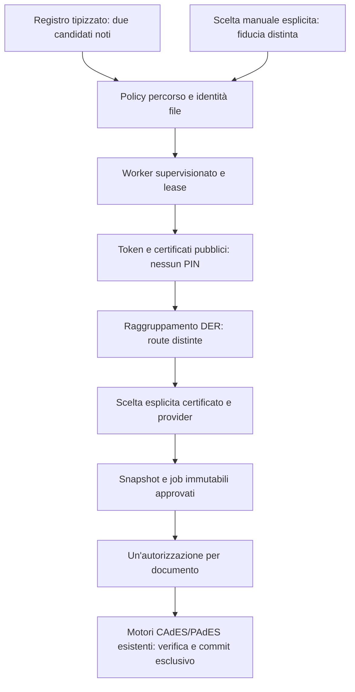

# Signum 0.4-A.2 — Device Discovery

**18 ottobre 2026 — implementazione M1–M4 completata, M5 analizzata con comportamento
sicuro conservato, M6 verificata localmente.** GUI interattiva e middleware reali
restano da collaudare su questo candidato. Non è una release pubblica.




## M1 — Base preservata

Branch `codex/signum-0.4-device-discovery` da `dd1e786`, versione 0.4-A.
Letti README, progressi 0.4, rapporti Foundation/PR2 e RELEASE_READINESS.
Review originale non tracciata preservata; nessuna modifica a main o altri repo.
Regressioni **prima del codice**: Swift 166/166 (helper nativo abilitato),
PKCS#11 40/40, PAdES 63/63. Log `discovery-baseline-*.log` sotto
`.build/reliability/evidence`. Solo fixture sintetiche, nessun hardware/PIN reale.

Registro tipizzato estensibile: Bit4id e OpenSC, con i due soli percorsi candidati
indicati. La presenza del percorso non implica caricabilità, dispositivo o firma.
Il collaudo 0.4-A DigitalDNA, tre firme valide/tre PIN, è riferito dall'utente:
non è una nuova prova eseguita in questa sessione né compatibilità generale.

## M2 — Discovery pubblica e caricamento

`MiddlewareDiscovery` separa presenza del software, sicurezza del percorso,
risposta del worker, presenza token e leggibilità dei certificati. Ricerca limitata
ai candidati noti; manuali solo per richiesta esplicita. Nessun Login/Sign.
Deadline globale (default 30 s, massimo 60), singola chiamata massimo 8 s,
32 token enumerati per modulo, 256 certificati/8 MiB aggregati. Lavoro off-main.
Crash/timeout/errori restano problemi di comunicazione, non assenza del token.
`CKR_USER_NOT_LOGGED_IN` pubblico ha uno stato distinto; una lista vuota non prova
l'assenza di certificati privati. Nessuna autenticazione proposta dalla discovery.

Automatici: proprietario root, niente scrittura gruppo/altri, niente ACL estese
con grant di scrittura (criterio conservativo anche per grant a root), file regolare,
componenti e antenati dei target symlink controllati in sola lettura. Nessuna
modifica ai permessi del software installato. Identità device/inode/size/mtime/ctime
controllata prima/dopo la ricerca e nel worker dopo la lease, prima del caricamento.
Il parent verifica il percorso canonico della risposta. Alias stesso inode non
vengono caricati due volte. I percorsi manuali hanno fiducia esplicita dell'utente
e conservano i controlli Foundation: non sono promossi a provider automatici.

**Test mirati M1+M2: 15/15.** Matrice installati/assenti, ACL reale sintetica,
permessi/ownership/antenati e symlink su filesystem simulato, symlink manuale reale,
identità modificata, alias, risposta estranea, deadline/cancel, worker sintetico
positivo/errore/hang/crash/autenticazione richiesta. Audit: nessun Login/Sign.
Il primo runner aveva un percorso worker errato nel test (xctest invece del
prodotto SwiftPM); corretto il fixture harness e ripetuta la suite con successo.
Non è stato caricato alcun middleware installato.

## M3 — Certificati e vie di accesso

Token: label/manufacturer/model/reader e seriale pubblico, più slot come localizzatore.
Versione opzionale via C_GetInfo nel worker supervisionato; mai usata per fiducia.
`DeviceCertificate` raggruppa soltanto DER uguali (SHA-256), conserva tutte le
`DeviceCertificateRoute` con provider/percorso/file identity/token/slot/object ID.
Non dichiara identità fisica condivisa fra moduli: questa non è dimostrabile con
la sola metadata PKCS#11 disponibile. Anche seriali uguali e nomi omonimi non
fondono certificati differenti. Lease fra provider diversi resta un limite noto.

Nome, organizzazione ed emittente vengono dal DER, scadenza/idoneità dalla policy
locale SG-04. Il nuovo flag clientAuth è solo descrittivo: nessuna modifica alle
regole di idoneità o alle primitive. `DeviceSelection` non preseleziona certificati,
invalida scelta/generazione al refresh e non effettua fallback, neppure al reinsert.
La route verifica l'identità corrente del modulo off-main prima del consenso;
job e motori continuano a vincolare provider/slot/ID/DER/snapshot immutabili.

**Test mirati M3 e regressioni collegate: 42/42.** Comprendono DER comune fra
provider/slot, omonimi con stesso seriale e diverso DER, firma/autenticazione/
scaduto/KU incompatibile/indeterminato, rimozione/reinsert/cambio slot e provider,
callback tardiva, sostituzione modulo dopo scelta e seriale letto nel figlio.
Non è stato effettuato alcun collaudo del middleware installato.

## M4 — Flusso GUI e consenso

All'apertura ricerca dei soli candidati noti in coda off-main, senza dlopen GUI.
Certificati in primo piano: titolare, organizzazione (se presente), emittente,
scadenza, uso/idoneità e dispositivo. Selezione sempre esplicita; certificati non
idonei ispezionabili ma non approvabili. «Configura dispositivo» mostra stato dei
software e possibilità di nuova ricerca; dettagli avanzati contengono percorsi,
versione, origine, file identity, seriale/slot/ID e vie alternative dello stesso DER.

Modulo manuale tramite inserimento o NSOpenPanel, caricamento **esplicito**.
UserDefaults conserva al massimo otto percorsi e il provider preferito, nessun PIN.
Un percorso ricordato non viene eseguito al lancio; una ricerca manuale sostituisce
le osservazioni precedenti, la ricerca ordinaria torna ai candidati noti. Rimuovere
una configurazione invalida la selezione; cambiare via cancella PIN e cache precedenti.
Refresh/cancel e callback tardive sono vincolati a generazioni. Il worker deve
confermare la nuova verifica di identità: una vecchia risposta priva della prova
non basta per la discovery automatica.

Il riepilogo conserva una sola conferma dell'insieme immutabile, distinta dal PIN
per documento. Destinazioni brevi; sorgenti omonime distinguibili con il minimo
suffisso di cartella necessario. Percorsi assoluti/hash nei dettagli tecnici.
Il modulo scelto viene ricontrollato off-main prima del consenso e prima di ogni
job; la route approvata resta congelata e non viene sostituita dopo errori.
Nessuna riscrittura del coordinatore, snapshot o motori di firma.

**Test mirati: 39/39, zero skip**, inclusi 12 batch e quattro nuovi test esperienza:
preferenze limitate/validate/rimovibili senza segreti o esecuzione implicita,
cambio route/PIN/DER, omonimi e ispezione di certificati non idonei. Un primo run
senza variabile helper saltava il caso misto PAdES opzionale; ripetuto con helper
esplicito, caso eseguito. Build SwiftUI riuscita. Click/layout interattivi non
ancora verificati; non è stata avviata una GUI che carichi middleware installati.

## M5 — Decisione sull'autenticazione batch

**Ottimizzazione non attivata.** Nessuna capability di sessione persistente è
stata dimostrata per DigitalDNA/OpenSC o per il percorso misto CAdES/PAdES.
La baseline GUI autorizza esplicitamente un documento per azione; il coordinatore
non contiene PIN, il campo viene svuotato prima dell'invio. Ogni job CAdES usa un
worker one-shot; ogni PAdES un helper nativo distinto con propria sessione e lease.
Questa architettura e l'interazione GUI spiegano le richieste indipendenti di
Signum, ma **non dimostrano** CKA_ALWAYS_AUTHENTICATE o la policy del token reale.
Tre firme/tre richieste PIN è il dato riferito dall'utente, non una diagnosi vendor.

Analisi del codice effettivo (`pkcs11_shim.c`, worker, helper e coordinatore):

| Passaggio | Comportamento conservato |
|---|---|
| Discovery / C_FindObjects | Sessioni pubbliche, nessun C_Login. DER pubblico letto nuovamente e vincolato prima dell'operazione privata. Auth richiesta dalla lettura segnalata senza tentativi |
| C_Login USER | Una chiamata per richiesta; stato condiviso già autenticato o race USER_ALREADY_LOGGED_IN rifiutati. Un successo altrui non verifica il PIN inserito da questa richiesta |
| C_FindObjects privato | Ricerca della chiave per ID nella sessione della richiesta; nessun passaggio a un'altra route se manca |
| C_SignInit | Meccanismo RSA/SHA-256 esistente, nessun cambiamento crittografico |
| CKA_ALWAYS_AUTHENTICATE | Letto sulla chiave dopo SignInit; se true, una sola login CONTEXT_SPECIFIC per quella firma. Attributo non leggibile non diventa capability batch |
| C_Login CONTEXT_SPECIFIC | Usa l'autorizzazione esplicita della firma corrente, senza cache fra job e senza retry dopo errore. Il protocollo esistente per singola firma non viene cambiato |
| C_Sign | Un tentativo; fallimento non causa un secondo tentativo o cambio middleware |
| Cleanup | Chiude solo le sessioni possedute, non C_Logout/C_CloseAllSessions indiscriminati. Errori di close/finalize non vengono mascherati; provider quarantinato nel figlio |
| Initialize/Finalize | Ownership in-process SG-02 conservata. Finalize soltanto per inizializzazione posseduta e ultimo riferimento; il worker non risponde prima del teardown verificato |
| Timeout/cancel/crash | Supervisione con TERM/KILL e lease fino alla morte; stato autenticato non riutilizzato. Dopo possibile operazione privata, esito incerto e nessuna prosecuzione automatica |

Riferimento normativo consultato: [OASIS PKCS#11 2.40, sezioni 4.9 e
C_CloseSession/C_Login/C_Logout](https://docs.oasis-open.org/pkcs11/pkcs11-base/v2.40/os/pkcs11-base-v2.40-os.html).
La specifica limita CONTEXT_SPECIFIC alla singola operazione con chiave che richiede
riautenticazione; la chiusura dell'ultima sessione riporta l'app allo stato pubblico.
Una sessione USER persistente potrebbe evitare login ripetute per alcuni token,
ma non prova autorizzazione unica o compatibilità della chiave scelta.

Un futuro worker per batch richiede sessione privata dedicata al dispositivo,
protocollo che mantenga job/snapshot/DER/route separati, capability dimostrata con
fixture e hardware autorizzato, nessun riuso automatico CONTEXT_SPECIFIC e teardown
su cancel/errori/timeout/crash. Non basta mantenere vivo il processo: occorre anche
mantenere la sessione corretta e rivedere l'helper PAdES senza indebolire isolamento,
verifica e pubblicazione. Le lease attuali coordinano provider/inode+slot; non
provano equivalenza fisica fra provider diversi e non controllano app terze.

Preferenza **solo progettuale**: «Automatica, quando supportata» / «Richiedi
un'autorizzazione per ogni documento». Nessun toggle operativo viene mostrato.
PIN mai salvato nei nuovi modelli/preferenze; restano i limiti della memoria
Swift/vendor e non viene promessa zeroizzazione completa. Nessun logout di sessioni
estranee per ottenere una nuova login.

**Verifica locale M5:** suite nativa PKCS#11 **40/40**, inclusi USER, CONTEXT,
ALWAYS_AUTHENTICATE, stato condiviso, errori PIN senza retry, zero Logout, rimozione,
errori e cleanup. M4 ha rieseguito batch con un Login/Sign per azione, cancel/esito
incerto e blocco della seconda autorizzazione concorrente. Nessuna sessione
persistente implementata o dichiarata testata; nessun hardware usato.

## M6 — Consolidamento del candidato

Ulteriori casi: symlink root verso antenato non privilegiato, versione C_GetInfo
opzionale e positiva, vecchio reply senza prova d'identità rifiutato, cancellazione
che invalida callback/stato, tre PAdES da route scoperta e applicazione di una
valutazione preparata off-main. Totale nuovo: **31 test**. Messaggi di file cambiato/
assente/non sicuro comprensibili, senza errori numerici generici. Il certificato
mostrato conserva il dispositivo della route effettivamente scelta, inclusa la via
alternativa. DER Base64 e metadata del token rimangono nei dettagli tecnici.
Metadati candidato **0.4.0/build 2**, macOS minimo 13.0, nessuna release.

Prima della creazione dei primi bundle: Swift completa **195/195**, zero skip; nativa
PKCS#11 **40/40**, PAdES Debug **63/63**, packaging Python **10/10**; ASAN e TSAN
mirati **33/33** ciascuno senza segnalazioni nei runner. ASAN leak detection
spenta; mock/terze parti non completamente strumentati, niente garanzia universale
su race/leak. Primo run completo: una regressione sulla descrizione pubblica Core
del tipo di dispositivo sconosciuto; ripristinata la descrizione conservativa
originale, senza portare il dettaglio tecnico nel flusso GUI. Suite ripetuta 195/195.
Un errore di ordine degli argomenti nel nuovo test versione è stato corretto
prima dei run positivi. Esiti finali e packaging sono registrati sotto.

### Risultati finali effettivamente eseguiti

Tutti i seguenti controlli sono locali, con documenti/certificati/chiavi software
sintetici, senza PIN personali o middleware hardware. I runner Swift finali sono
stati ripetuti sul codice committato `2a27cad`. Il nuovo test tre PAdES usa
la route scelta esplicitamente, conserva snapshot/job/hash e richiede tre azioni
distinte, senza Logout. `DeviceDiscoveryResult` prepara valutazioni X.509 e
raggruppamento fuori dal thread GUI; il callback applica soltanto quel risultato
immutabile, senza nuove letture di file/provider o analisi dei certificati.

| Controllo | Risultato |
|---|---|
| Suite Swift completa, helper PAdES esplicito | **197/197**, nessuno skip o fallimento |
| PKCS#11 C/C++ | **40/40** |
| PAdES Debug / Release | **63/63** per configurazione |
| Build Swift di tutti i prodotti Debug / Release | riuscite |
| Test Python packaging | **10/10** |
| ASAN mirato discovery/selezione/preferenze, provider e tre PAdES | **35/35**, nessuna segnalazione nel runner |
| TSAN sugli stessi casi | **35/35**, nessuna segnalazione nel runner |
| Bundle Debug / Release | ad hoc, audit dipendenze/percorsi/Mach-O, firma stretta e rilocazione riusciti |
| Helper PAdES incorporato, prima/dopo rilocazione | **63/63** per configurazione e posizione |
| Nuova demo sintetica + discovery/certificato via CLI/worker del bundle Release | riuscite, ID pubblico 53, idoneo localmente, nessuna firma avviata dalla demo |

Le regressioni comprendono CAdES/PAdES singole, tre CAdES, PAdES multipli/batch
misti, snapshot invariati nonostante modifiche agli originali, collisioni,
verifica e pubblicazione esclusiva, errori pre-commit, selezione congelata,
cancel/crash/timeout e nessun retry. ASAN: `detect_leaks=0`; mock e dipendenze non
interamente strumentati. I canali vendor dei figli restano silenziati dal prodotto:
nessuna deduzione di assenza universale di race/leak dai soli runner positivi.

Bundle nuovi, precedenti Alpha e candidati preservati:
- `.build/04a2-bundles/final-debug/Signum.app`
- `.build/04a2-bundles/final-release/Signum.app`

Manifesti: `sourceCommit: 2a27cad`, `sourceTrackedDirty: false`, versione
**0.4.0/build 2**, arm64, minimo Info.plist e massimo Mach-O **13.0**.
Verifica finale `codesign --verify --deep --strict` riuscita per entrambi.
I precedenti checkpoint `debug/release` restano sul disco e sono superati da
questi due candidati finali. Hash del codice annidato ricontrollati; helper nativo
identico in byte a quello usato nell’ultima suite Swift. Firma solo **ad hoc**; nessun Developer ID, notarizzazione, DMG o release.
Nessun bundle è stato avviato automaticamente nella GUI per caricare i provider
installati. La costruzione/verifica non equivale a click/layout interattivi.

### Compatibilità verificata e limiti

| Provider / ambiente | Evidenza effettiva |
|---|---|
| Bit4id | Registro/candidato e matrice di disponibilità/security testati con filesystem e worker sintetici. Nessuna nuova esecuzione della libreria installata. DigitalDNA/DS3 della precedente 0.4-A: collaudo riferito dall'utente, non prova di questa nuova discovery |
| OpenSC | Registro/candidato e stessa matrice sintetica. Nessun token OpenSC reale testato; nessuna promessa per tutti i dispositivi supportati dal progetto OpenSC |
| Modulo manuale sintetico | Worker, seriale, metadata opzionale, certificati e motori verificati; fiducia esplicita distinta da discovery automatica |
| macOS 13 / 14 | Target 13 coerente e audit Mach-O passati; runtime su quegli OS **non testato**. Host macOS 27.2 arm64, Swift 6.4, SDK 27.0 |

- Ricerca automatica all'apertura e su «Cerca nuovamente», non monitoraggio USB
  continuo. Rimozione/reinsert/cambio slot richiedono una nuova ricerca e scelta;
  la vista può mostrare l'ultima osservazione fino al refresh. I motori rileggono
  il DER approvato prima dell'autenticazione e non cambiano slot/provider.
- La leggibilità pubblica non prova accesso alla chiave privata o successo della
  firma. Enumerazione autenticata dei certificati privati **non implementata**:
  stato esplicito auth-required quando segnalato; lista vuota resta ambigua.
- Label, seriale e metadata vendor non sono prove crittografiche di identità fisica.
  Due route dello stesso DER restano distinguibili; lease cross-provider/alias
  fisici e app terze rimangono limiti Foundation. Non si effettua fallback.
- La policy automatica può rifiutare installazioni legittime con ownership/ACL
  permissive: non abbassa silenziosamente i controlli. Manuale è una scelta di
  fiducia esplicita, non un'autorizzazione permanente a eseguire quel percorso.
- I controlli di percorso ripetuti proteggono contro componenti scrivibili da
  utenti non privilegiati e rilevano cambi osservabili. Non sono un sigillo contro
  root/amministratore, codice ostile nello stesso account o ogni TOCTOU fra check
  e dlopen nei percorsi manuali. Identità file non equivale ad autenticità vendor.
- Il worker contiene hang/crash ma **non è una sandbox** contro codice malevolo.
  Dipendenze/plugin/configurazioni/caricamenti dinamici decisi dal vendor non
  ricevono una verifica transitiva completa da questa policy del candidato.
  Le chiamate filesystem/kernel bloccate non diventano tutte interrompibili.
- GUI compilata e modelli testati; collaudo interattivo di testo/layout, dispositivi
  effettivi, tempi di inizializzazione e due finestre resta un gate manuale.
  Sicurezza del fornitore, macOS minimo/Mac pulito e distribuzione restano aperti.
- Autenticazione unica, sessione persistente e relativo toggle **rinviati**.
  Nessun cambiamento a primitive RSA/CMS/PDF, snapshot o commit Foundation;
  il flag clientAuth aggiunto è solo descrittivo e non cambia la policy SG-04.

### Riprodurre le verifiche

Con le dipendenze locali già presenti, dal workspace:

```sh
SIGNUM_NATIVE_PREFIX="$PWD/.build/pr2-native-macos13/prefix" SIGNUM_PADES_TEST_BUILD="$PWD/.build/pr2-pades-debug" scripts/test-pades-local.sh
SIGNUM_TEST_PADES_HELPER="$PWD/.build/pr2-pades-debug/signum-pades-local" swift test --scratch-path .build/reliability
scripts/test-pkcs11-local.sh
swift build -c debug --scratch-path .build/reliability
swift build -c release --scratch-path .build/reliability
/usr/bin/python3 -m unittest discover -s scripts/tests -v
ASAN_OPTIONS=detect_leaks=0 swift test --scratch-path .build/reliability-asan --sanitize address --filter 'MiddlewareRegistryTests|MiddlewareDiscoveryTests|DeviceSelectionTests|DiscoveryExperienceTests|ProviderSelectionTests|BatchSigningTests.testThreePAdES'
swift test --scratch-path .build/beta-tsan --sanitize thread --filter 'MiddlewareRegistryTests|MiddlewareDiscoveryTests|DeviceSelectionTests|DiscoveryExperienceTests|ProviderSelectionTests|BatchSigningTests.testThreePAdES'
```

La ricetta `scripts/build-beta-app.py --configuration debug|release` con
`--native-prefix .build/pr2-native-macos13/prefix --output <nuova-directory>/Signum.app`
compila e testa anche PAdES nativo e bundle rilocati; usare una directory nuova,
mai una precedente Alpha. Nessuna installazione/download globale o CI remoto.
Evidenze ignorate da Git: `.build/reliability/evidence/discovery-*.log`;
`discovery-final-*`, `discovery-package-*`, `discovery-build-*`, `discovery-codesign.log`.

### Collaudo manuale predisposto, non eseguito

**Prima prova senza hardware:** demo già preparata in `.build/04a2-demo`.
Per rigenerare scegliere un altro output nuovo con `scripts/prepare-batch-demo.py`.
1. Senza token collegati, aprire il nuovo bundle Release indicato sopra.
2. «Configura dispositivo» → «Impostazioni avanzate» → scegliere esplicitamente
   `.build/04a2-demo/synthetic-provider.dylib` → «Carica manuale». Non deve essere
   eseguito automaticamente perché la directory è dell'utente. Scegliere il
   certificato sintetico; controllare titolare/idoneità e i dettagli del provider.
3. Aggiungere i tre testi della cartella `documents`, poi il PDF come PAdES.
   Aprire l'anteprima dello snapshot; provare duplicato, rimozione e omonimi.
4. «Conferma firma» → cartella demo `output` → verificare nomi/formati/firmatario e
   destinazioni brevi; controllare percorsi/hash nei dettagli. Annullare la prima
   conferma e verificare che non partano firme; confermare poi la lista definitiva.
5. Usare esclusivamente una stringa fittizia non vuota per il mock, mai un PIN
   personale. Autorizzare un documento alla volta: il campo deve svuotarsi e il
   successivo deve attendere. Controllare report/output; nessun overwrite.
6. Verificare rimozione configurazione, ricerca annullata, nuova ricerca e scelta
   esplicita senza recupero di PIN o route precedente. L'avvio successivo deve
   ricordare il percorso ma non eseguirlo automaticamente.

**Hardware, soltanto in una futura sessione avviata esplicitamente dall'utente:**
1. Aprire il preciso nuovo candidato. Bit4id/OpenSC, se installati e sicuri, sono
   candidati automatici; verificare nome software selezionato e certificato.
   Se non pronto, usare «Cerca nuovamente»; un timeout non deve dire token assente.
2. Con documenti sintetici, provare un CAdES e un PAdES e il batch di tre documenti;
   inserire il PIN soltanto nel campo previsto, mai in comandi/log. Verificare
   copie con InfoCamere, separatamente dai controlli locali di Signum.
3. Se presenti entrambi i moduli, scegliere esplicitamente le route nei dettagli
   avanzati e provarle separatamente; nessun cambio di provider a metà batch.
4. Provare rimozione/reinsert in idle e nuova ricerca, cambi di slot/certificato,
   due finestre sullo stesso provider/slot e cancellazione. Se un esito è incerto,
   fermarsi e controllare dispositivo/file senza ripetere automaticamente la firma.
5. Registrare solo OS, versioni middleware, route, fase/tempi e risultati, senza
   PIN, documenti personali o diagnostica vendor grezza. Non dedurre supporto
   universale o qualificazione eIDAS da questi singoli collaudi.

### Commit locali e stato preservato

| Milestone | Commit | Contenuto |
|---|---|---|
| M1 | `de0b613` | Baseline 0.4-A, registro e test |
| M2 | `5c13943` | Discovery supervisionata, policy percorso/ACL, test |
| M3 | `0590b2b` | Token/seriale/versione, certificati e route distinte |
| M4 | `eeac0c3` | GUI certificato-first, configurazione avanzata e consenso |
| M5 | `cfb5905` | Analisi autenticazione, mantenuta autorizzazione per documento |
| M6 codice | `02f94a3` | Regressioni aggiuntive, messaggi, candidato build 2 |
| M6 PAdES batch | `eacc41b` | Tre PDF approvati da route scoperta, tre azioni distinte |
| M6 reattività | `2a27cad` | Preparazione certificati off-main, 8 test selezione |

Il commit documentale di consegna successivo registra questi risultati e aggiorna
il file progressi. Branch `codex/signum-0.4-device-discovery`, da `dd1e786`;
il precedente branch 0.4-A resta invariato. `main` resta
`be84a1e44f3b0bbe41bee9a2f46dbed36342ab70`. Unico file non tracciato: review originale
`docs/CODE_REVIEW_SIGNUM_0.3.3_2026-10-17.md`, SHA-256 invariato
`2f275328cdca3ebe2023ade1c87b3179bc89540af8d7a898b304241d61a168a6`.
Nessun push/merge/tag/release/GitHub Actions; nessun accesso o modifica a HalleyMac,
nessuna sostituzione dell'Alpha, nessun hardware/PIN personale usato.
